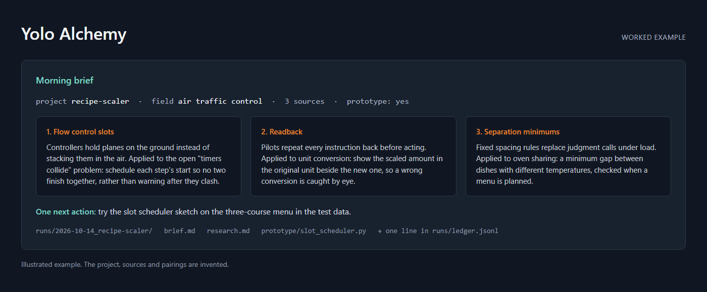

# yolo-alchemy

Transmute expiring AI quota into cross-domain gold. Weekly usage you haven't spent when the limit resets is simply lost, so this is an overnight scheduled agent run that spends it on **speculative cross-domain research** paired against your real projects.

What a run does:

1. Picks one of your projects and reads its goals and open problems.
2. Researches one genuinely unrelated field (biology, logistics, urban planning and so on), extracts *mechanisms* (how that field solves its problems), and forces 2–3 pairings onto the project's open problems, prototyping the best one if it fits in an hour.
3. Leaves a morning brief on disk, one JSON line in an append-only research ledger (so a month of runs stays analyzable in one read), and a short notification if your session has a way to send one.

Hard rules baked into the spec: never write inside the target project, never touch git, read project data read-only, stop and write the brief on any rate-limit error. The run's own session doubles as the warmest place to say "do it": adoption lifts the unattended-run restrictions and hands the work to the project's normal rules.

Its first live run found a real, measurable pricing bug in the target project.

## Install

As a plugin: **Mackforge Yolo Alchemy** in the [mackforge-skills](https://github.com/dtiger1889-ops/mackforge-skills/tree/main/plugins/mackforge-yolo-alchemy) collection. In Claude Code: `/plugin marketplace add dtiger1889-ops/mackforge-skills`, then `/plugin install mackforge-yolo-alchemy@mackforge`.

By hand: copy [`SKILL.md`](SKILL.md) into your agent's skills folder as `yolo-alchemy/SKILL.md`.

Then schedule it for the evening before your weekly reset, started in the folder that holds your projects, with the prompt `/yolo-alchemy`. The schedule is the budget control.

## Why there is no usage check

Earlier versions shipped a gate script that read the account's usage through an undocumented endpoint and skipped nights with no surplus. It used the login token Claude Code caches on disk, and that token goes stale for scheduled runs: a run with no terminal attached never refreshes it, so it can sit expired for hours or days. The gate failed safe, which meant it silently skipped real nights whenever the token was old. It also needed a credential from your machine and a script runtime, both things a stranger's setup may not have. Scheduling the run for the evening before the reset does the same job with neither.

## License

MIT. See [LICENSE](LICENSE).
